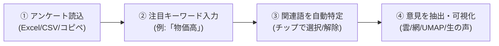

# キーワード連想＆意見深掘りツール (Survey Focus Explorer)

アンケートの自由記述テキストから、**指定したキーワード（例：「物価高」など）と文脈上関連性の近い単語群を自動特定**し、それらを含む意見のみを抽出して、**ワードクラウド・共起ネットワーク・UMAP（非線形次元削減）・属性別クロス集計などで多角的に深掘り分析**するWebアプリケーションです。

外部サーバーへデータを一切送信せず、お使いのWebブラウザ内（ローカル環境）で高速かつ安全に処理が完結します。

---

## 📌 目次
1. [本ツールの特長](#1-本ツールの特長)
2. [クイックスタート（使い方の流れ）](#2-クイックスタート使い方の流れ)
3. [分析・可視化機能](#3-分析可視化機能)
4. [起動方法・動作環境](#4-起動方法動作環境)
5. [アルゴリズムと内部処理](#5-アルゴリズムと内部処理)
6. [ディレクトリ構成・使用ライブラリ](#6-ディレクトリ構成使用ライブラリ)

---

## 1. 本ツールの特長

* 🎯 **特定キーワードのピンポイント深掘り（複数キーワード・OR探索対応）**:
  全体分析では埋もれてしまいがちな関心テーマを抽出し、その周辺で語られている生の声と文脈を浮き彫りにします。単一キーワードだけでなく、**カンマや読点、空白で区切って複数の単語（例: `中東, イラン, イスラエル`）を指定するOR条件探索**にも対応。名寄せで固有の単語表記を消去することなく、テーマ全体を束ねて深掘りできます。
* 💡 **関連語の自動特定（共起・文脈近傍語）**:
  指定キーワードそのものだけでなく、同じ文脈で一緒に語られやすい関連語（例：「値上げ」「負担」「食費」「電気代」など）を共起度（Jaccard係数・相互情報量）から自動特定。チップをクリックして対象語を自由に取捨選択できます。
  複数キーワード指定時は、各キーワード個別の該当件数内訳も案内バッジに自動表示されます。
* 🔒 **安心の完全オフライン動作**:
  社外秘アンケートや個人情報を含む自由記述も、ブラウザ外へ送信されることは一切ありません。
* 📊 **豊富な可視化ダッシュボード**:
  ワードクラウド、物理演算共起ネットワーク、UMAP散布図、属性別クロス集計、ハイライト付き生の声一覧をワンクリックで切り替え。
* 📁 **柔軟なデータ取り込み**:
  Excel (.xlsx)、CSV、TSV、1行1回答のテキストファイルに対応（Shift_JIS / UTF-8 自動判別）。Excelからの直接コピペ入力も可能です。

---

## 2. クイックスタート（使い方の流れ）



1. **データ投入**:
   - お手元のファイルをドラッグ＆ドロップするか、画面右上の **「💡 デモデータで試す」** をクリックします。
   - 自由記述列・属性列（年代や性別など）を確認します。
2. **キーワード指定 ＆ 関連語の特定**:
   - 注目したい単語（例: `物価高`）を入力し、右隣の **「🚀 関連語を探索 ＆ 分析スタート」**（または件数表示ボタン）を押します。
   - **複数キーワードのOR指定**: カンマ（`,` や `、`）または空白で区切って複数単語（例: `中東, イラン, イスラエル`）を入力すると、いずれかを含む意見群を束ねた総合的な関連語探索が可能です。
   - 自動特定された関連語チップ（例: `値上げ`、`負担`、`食費` など）を確認し、必要に応じてオン/オフを切り替えます。
3. **多角的な分析**:
   - 上部のタブを切り替えて、ワードクラウド、共起ネットワーク、UMAP散布図、属性別集計、生の声一覧を閲覧します。

---

## 3. 分析・可視化機能

### 3-1. 📑 意見集約・論点サマリー（抽出型要約 ＆ トピック分類）
* **全体代表意見（抽出型要約）**:
  外部LLMを使用せず、文書間コサイン類似度セントロイド法（Centroid法）と適合度スコアリングにより、意見群全体の主旨を最も象徴する回答文トップ3〜4件を自動選定して提示します。大量の生の声を読む前に、意見の核心を一瞬で把握できます。
* **主要論点グループ（トピック別サマリーカード）**:
  意見群を共起クラスタリングにより論点グループに自動分類。「特徴キーワード」「該当件数・シェア」「論点内の代表的な生の声」をまとめたカードを表示します。カードをクリックすると、その論点に絞り込んだ生の声一覧へドリルダウンできます。
* **意見タイプ構成比（ルールベース自動分類）**:
  文末表現や構文パターンから、「🔴 困りごと・課題」「🔵 要望・改善提案」「🟢 肯定・満足」「⚪ その他・事実」を自動判定し、割合プログレスバーで可視化します。
* **全体比の特異キーワード（オッズ比ランキング）**:
  アンケート全体の平均出現率と比較して、この意見群において突出して多く使われている特異単語（オッズ比倍率）をランキング表示します。
* **📋 Markdownレポートのワンクリックコピー**:
  集約結果（キーワード、意見タイプ構成、代表意見、各論点の要約、特徴語）を美しく整形されたMarkdown形式でクリップボードにコピー可能。社内チャットや報告資料へそのまま貼り付けられます。

### 3-2. ☁️ ワードクラウド
* 抽出された関連意見群の中で、特に多く使われている単語を視覚化します。
* **形状指定**: 自然な広がりを持つ「雲形（楕円）」と、領域全体を活用する「長方形（矩形）」を用途に応じて切り替え可能。
* **利用単語数の指定**: 候補リストからの選択に加え、10〜300語の範囲で自由な数値を直接指定可能。単語数に応じたフォントサイズ自動スケーリングにも対応。
* **横書き固定**: 報告書やプレゼン資料での視認性を最優先し、すべての単語を水平方向（横書き）に固定して整然と描画。
* **重要度基準**: 「出現頻度順」と、その意見群特有の語を強調する「特徴度 (TF-IDF) 順」を切り替え可能。
* 単語をクリックすると、該当する生の声一覧へジャンプします。

### 3-3. 🕸️ 共起ネットワーク
* 単語同士の結びつき（同時に語られやすい関係）を物理演算（Force-Directed）によってネットワーク図として可視化します。
* 指定キーワードは中心ハブとして目立つカラーで強調され、話題のサブグループ（コミュニティ）ごとに色分けされます。
* ノードのドラッグ移動、ホイールによる拡大縮小、ホバーによる接続線のハイライトに対応しています。

### 3-4. 🌌 UMAP 散布図 (非線形次元削減)
* 高次元の文脈情報を非線形多様体学習（UMAP）により2次元平面に圧縮・射影します。
* **［単語マップ］**: 文脈上近い使われ方をしている単語同士が近くに集まり、トピックのまとまり（クラスタ）を把握できます。
* **［意見マップ］**: 回答テキスト同士の類似度から意見のサブタイプを自動分類します。

### 3-5. 📊 属性別集計 (クロス集計)
* 属性列（年代、性別、満足度など）が指定されている場合、各属性グループにおけるキーワード関連意見の「言及割合 (%)」を横棒グラフで比較します。

### 3-6. 💬 抽出された生の声一覧
* 抽出された回答文をカード形式で一覧表示します。
* **適合度スコア順（推奨）**、回答順、文字数順の並び替えに対応。
* **意見タイプ別絞り込み**（困りごと/要望/肯定/中立）に対応。
* 指定キーワード（ローズレッド）や関連語（スカイブルー）がハイライト表示され、前後の文脈が一目で分かります。
* テキスト絞り込み検索や、抽出結果のCSVダウンロードに対応しています。

### 3-7. 🖨️ A4サマリーレポート出力（印刷 / PDF保存）
* 画面上部の「🖨️ レポート出力」ボタンから、ワンクリックで報告書仕様の**A4用紙・全4枚サマリーレポート**をプレビュー＆印刷（PDF保存）可能。
* **資料を使った説明・プレゼンに最適な4部構成ストーリー（全8セクション）**:
  - **【第1ページ】（１）アンケートの概要 ＆ 全体要約サマリー**
    1. **投入したデータ全体の概要**: ファイル名、総回答数、分析列、全体属性構成
    2. **指定キーワード ＆ 判定関連語の概要**: 注目語、代表形、抽出条件、採用関連語リスト・判定基準
    3. **分析対象（該当意見群）の概要**: 全体数・絞込後件数・該当数・カバー率の4連KPI、該当意見の属性内訳
    4. **要約サマリー（集約概要 ＆ 代表意見）**: 意見タイプの自動分類基準解説、意見タイプ構成比バー、困りごと・要望・肯定の代表的な生の声（各5選）
  - **【第2ページ】（２）キーワードと関連語の使用状況（属性分解前の全体状況・可視化集約）**
    5. **【全体状況】語彙・話題構造（ワードクラウド ＆ 全体共起ネットワーク）**: 属性毎に分解する前の意見全体の頻出語ビジュアル（大画面ワードクラウド・高さ56mm）と、文脈クラスタ・話題マップ（大画面単語共起ネットワーク・高さ56mm）を左右並置で集約
    6. **【全体状況】頻出・特異語彙 ＆ 意見分布構造（UMAP散布図 ＆ 主要クラスタ）**: 頻出単語Top15表 ＆ 全体比特異語（オッズ比）、発言の意味的類似度マップ（大画面UMAP散布図・高さ68mm）と主要クラスタ傾向表を左右並置で集約
  - **【第3ページ】（３）属性情報とキーワード関連語の結びつき構造（属性別結びつきネットワーク ＆ 特有語vs共通語対照）**
    7. **【属性ごとの状況】属性別 結びつきネットワーク（特徴語重視 ＆ 頻度重視） ＆ 特有語vs共通・高頻度語補完サマリー**: セグメント特有の独自関心をあぶり出す「特徴度重視」と、共通の基本関心を捉える「頻度重視」の2視点をそれぞれ全幅ワイドな大画面（高さ82mm）で上下に大きく展開。さらに最下段には各属性の「特徴的に関連する語（他属性比で突出した特有語）」と「共通・高頻度に関連する語（基本語）」をコンパクトにまとめた補完サマリー表を配置し、グラフの主役感を保ちながら解釈をスマートにアシスト。
  - **【第4ページ】（４）属性情報とキーワード関連語のクロス分析 ＆ 生の声（セグメント深掘り）**
    8. **【属性ごとの状況】属性別クロス集計 ＆ 属性項目ごとの代表意見（生の声）**: 整理属性を明記した言及傾向グラフ（高さ48mm）・クロス詳細表、および各属性カテゴリで最も象徴的・適合度の高い代表的な生の声（各属性2〜3例のカードリスト形式）を1ページ丸ごと使ってゆったりと網羅。
* 図表が分散せず「全体状況（第2ページ）」、「属性結びつき構造（第3ページ）」、「クロス集計と生の声（第4ページ）」に綺麗にかたまって表現され、各図のサイズ拡大や生の声の複数例表示を実現しながら、A4用紙全4枚のページ数を完全に維持しています。各図のタイトルに対象キーワード、クロス集計に整理属性が明記されます。

### 3-8. ⛶ 全画面最大化 ＆ 個別グラフの保存・印刷
* 各図（ワードクラウド、共起ネットワーク、UMAP散布図、属性別クロス集計）で**「⛶ 全画面」**ボタンを押すと、画面中央に4:3比率で最大化表示されます。
* **全画面でのシームレスな保存・印刷（UIの集約整理）**:
  - 画像保存・Officeコピー・印刷の各ボタンを全画面表示時のフローティングバーにスマートに集約配置（通常ツールバーの重複ボタンを整理し、画面を広くクリアに維持）。
  - 全画面表示中に上部バーから**「📷 画像保存 (PNG)」「📋 Officeへコピー」「🖨️ 印刷」「✕ 全画面を終了」**をダイレクトに操作可能。
  - 全画面表示中にキーボードの **`Ctrl+P` (Macは `Cmd+P`)** を押すだけで即座に単体グラフ印刷を呼び出せます。
* **作成条件（設定パラメータ）明記＆高精細用紙フィット印刷（PDF保存）**:
  - 全画面バーの**「🖨️ 印刷」**ボタンから、用紙1枚（A4横・縦対応）にぴったり収まる単体グラフ印刷・PDF出力が可能。
  - 用紙上部に**「図のタイトル」「対象キーワード」「該当意見数・カバー率」**に加え、**「作成条件（例: 特徴度(TF-IDF)順 / 上位80語 / 雲形 など）」**が自動印字され、どのような集計条件で出力したかが一目で分かります。
  - 用紙下部には出力日時が自動付与され、会議資料やエビデンスとしてそのまま活用できます。

---

## 4. 起動方法・動作環境

* **動作環境**: Google Chrome, Microsoft Edge, Safari 等のモダンWebブラウザ

### Windows の場合
同梱の **`kidou.bat`** をダブルクリックして起動します。
（ブラウザのローカルファイルセキュリティ制限を自動バイパスして開きます）

### Linux / Mac の場合
ターミナルで以下のスクリプトを実行します。
```bash
./start_server.sh
```
または Python の簡易サーバーを起動してアクセスしてください。
```bash
python3 -m http.server 8080
# ブラウザで http://localhost:8080 を開く
```

---

## 5. アルゴリズムと内部処理

* **形態素解析**: `kuromoji.js` による日本語単語分割、複合名詞の結合、ストップワード除外。
* **関連語探索**: 単語間共起度に基づく Jaccard 係数および点別相互情報量（PMI）の算出。ノイズとなる低頻度語をフィルタリングし、上位関連語をスコアリング。
* **意見フィルタリング**: 指定キーワードおよび採用関連語の部分一致・形態素一致による高速マッチング。
* **次元削減**: 純粋JavaScript実装による UMAP 最適化（KNNグラフ + ファジィ単体集合 + 確率的勾配降下法 SGD）および K-Means クラスタリング。

---

## 6. ディレクトリ構成・使用ライブラリ

```text
survey-focus-explorer/
├── index.html              # メイン画面
├── kidou.bat               # Windows用起動バッチ
├── start_server.sh         # Linux/Mac用起動スクリプト
├── css/
│   └── style.css           # UI・ダッシュボードデザイン
├── js/
│   ├── app.js              # 全体オーケストレーション・UIイベント
│   ├── csv_parser.js       # Excel/CSVパース・列判定
│   ├── stopwords_default.js# 基本ストップワード定義
│   ├── text_preprocessor.js# 形態素解析・辞書前処理
│   ├── association_engine.js # キーワード関連語探索・意見抽出エンジン
│   ├── visualizers/
│   │   ├── wordcloud.js    # ワードクラウド描画
│   │   ├── network.js      # 共起ネットワーク物理演算描画
│   │   ├── umap_view.js    # UMAP次元削減＆クラスタリング描画
│   │   └── attr_charts.js  # 属性別Plotlyクロス集計
│   └── demo_data.js        # デモ用アンケートデータ
├── data/
│   ├── sample_survey.csv   # サンプルアンケートCSV
│   ├── stopwords.txt       # 標準ストップワードリスト
│   └── custom_rules.txt    # 辞書・ルール見本
├── lib/
│   ├── kuromoji/           # 形態素解析器＆辞書
│   ├── wordcloud2.min.js   # ワードクラウドライブラリ
│   ├── plotly.min.js       # チャートライブラリ
│   ├── xlsx.full.min.js    # Excelパーサー
│   └── papaparse.min.js    # CSVパーサー
├── work/                   # 作業用一時ディレクトリ
└── README.md               # 本ドキュメント
```

### 使用ライブラリ
* [Kuromoji.js](https://github.com/takuyaa/kuromoji.js/) (Apache-2.0)
* [wordcloud2.js](https://github.com/timdream/wordcloud2.js/) (MIT)
* [Plotly.js](https://plotly.com/javascript/) (MIT)
* [PapaParse](https://www.papaparse.com/) (MIT)
* [SheetJS (xlsx)](https://sheetjs.com/) (Apache-2.0)
