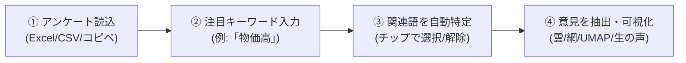

# アンケート・キーワード連想＆意見深掘りツール (Survey Focus Explorer)

アンケートの自由記述テキストから、**指定したキーワード（例：「物価高」など）と文脈上関連性の近い単語群を自動特定**し、それらを含む意見のみを抽出して、**ワードクラウド・共起ネットワーク・UMAP（非線形次元削減）・属性別クロス集計などで多角的に深掘り分析**するWebアプリケーションです。

外部サーバーへデータを一切送信せず、お使いのWebブラウザ内（ローカル環境）で高速かつ安全に処理が完結します。

---

## 📌 目次
1. [本ツールの特長](#1-本ツールの特長)
2. [クイックスタート（使い方の流れ）](#2-クイックスタート使い方の流れ)
3. [分析・可視化機能](#3-分析可視化機能)
4. [起動方法・動作環境](#4-起動方法動作環境)
5. [アルゴリズムと内部処理](#5-アルゴリズムと内部処理)
6. [ディレクトリ構成・使用ライブラリ](#6-ディレクトリ構成使用ライブラリ)

---

## 1. 本ツールの特長

* 🎯 **特定キーワードのピンポイント深掘り**:
  全体分析では埋もれてしまいがちな関心テーマ（「物価高」「サポート対応」「UI」など）を抽出し、その周辺で語られている生の声と文脈を浮き彫りにします。
* 💡 **関連語の自動特定（共起・文脈近傍語）**:
  指定キーワードそのものだけでなく、同じ文脈で一緒に語られやすい関連語（例：「値上げ」「負担」「食費」「電気代」など）を共起度（Jaccard係数・相互情報量）から自動特定。チップをクリックして対象語を自由に取捨選択できます。
* 🔒 **安心の完全オフライン動作**:
  社外秘アンケートや個人情報を含む自由記述も、ブラウザ外へ送信されることは一切ありません。
* 📊 **豊富な可視化ダッシュボード**:
  ワードクラウド、物理演算共起ネットワーク、UMAP散布図、属性別クロス集計、ハイライト付き生の声一覧をワンクリックで切り替え。
* 📁 **柔軟なデータ取り込み**:
  Excel (.xlsx)、CSV、TSV、1行1回答のテキストファイルに対応（Shift_JIS / UTF-8 自動判別）。Excelからの直接コピペ入力も可能です。

---

## 2. クイックスタート（使い方の流れ）



1. **データ投入**:
   - お手元のファイルをドラッグ＆ドロップするか、画面右上の **「💡 デモデータで試す」** をクリックします。
   - 自由記述列・属性列（年代や性別など）を確認します。
2. **キーワード指定 ＆ 関連語の特定**:
   - 注目したい単語（例: `物価高`）を入力し、**「🚀 関連語を探索 ＆ 分析」** を押します。
   - 自動特定された関連語チップ（例: `値上げ`、`負担`、`食費` など）を確認し、必要に応じてオン/オフを切り替えます。
3. **多角的な分析**:
   - 上部のタブを切り替えて、ワードクラウド、共起ネットワーク、UMAP散布図、属性別集計、生の声一覧を閲覧します。

---

## 3. 分析・可視化機能

### 3-1. 📑 意見集約・論点サマリー（抽出型要約 ＆ トピック分類）
* **全体代表意見（抽出型要約）**:
  外部LLMを使用せず、文書間コサイン類似度セントロイド法（Centroid法）と適合度スコアリングにより、意見群全体の主旨を最も象徴する回答文トップ3〜4件を自動選定して提示します。大量の生の声を読む前に、意見の核心を一瞬で把握できます。
* **主要論点グループ（トピック別サマリーカード）**:
  意見群を共起クラスタリングにより論点グループに自動分類。「特徴キーワード」「該当件数・シェア」「論点内の代表的な生の声」をまとめたカードを表示します。カードをクリックすると、その論点に絞り込んだ生の声一覧へドリルダウンできます。
* **意見タイプ構成比（ルールベース自動分類）**:
  文末表現や構文パターンから、「🔴 困りごと・課題」「🔵 要望・改善提案」「🟢 肯定・満足」「⚪ その他・事実」を自動判定し、割合プログレスバーで可視化します。
* **全体比の特異キーワード（オッズ比ランキング）**:
  アンケート全体の平均出現率と比較して、この意見群において突出して多く使われている特異単語（オッズ比倍率）をランキング表示します。
* **📋 Markdownレポートのワンクリックコピー**:
  集約結果（キーワード、意見タイプ構成、代表意見、各論点の要約、特徴語）を美しく整形されたMarkdown形式でクリップボードにコピー可能。社内チャットや報告資料へそのまま貼り付けられます。

### 3-2. ☁️ ワードクラウド
* 抽出された関連意見群の中で、特に多く使われている単語を視覚化します。
* 「出現頻度順」と、その意見群特有の語を強調する「特徴度 (TF-IDF) 順」を切り替え可能です。
* 単語をクリックすると、該当する生の声一覧へジャンプします。

### 3-3. 🕸️ 共起ネットワーク
* 単語同士の結びつき（同時に語られやすい関係）を物理演算（Force-Directed）によってネットワーク図として可視化します。
* 指定キーワードは中心ハブとして目立つカラーで強調され、話題のサブグループ（コミュニティ）ごとに色分けされます。
* ノードのドラッグ移動、ホイールによる拡大縮小、ホバーによる接続線のハイライトに対応しています。

### 3-4. 🌌 UMAP 散布図 (非線形次元削減)
* 高次元の文脈情報を非線形多様体学習（UMAP）により2次元平面に圧縮・射影します。
* **［単語マップ］**: 文脈上近い使われ方をしている単語同士が近くに集まり、トピックのまとまり（クラスタ）を把握できます。
* **［意見マップ］**: 回答テキスト同士の類似度から意見のサブタイプを自動分類します。

### 3-5. 📊 属性別集計 (クロス集計)
* 属性列（年代、性別、満足度など）が指定されている場合、各属性グループにおけるキーワード関連意見の「言及割合 (%)」を横棒グラフで比較します。

### 3-6. 💬 抽出された生の声一覧
* 抽出された回答文をカード形式で一覧表示します。
* **適合度スコア順（推奨）**、回答順、文字数順の並び替えに対応。
* **意見タイプ別絞り込み**（困りごと/要望/肯定/中立）に対応。
* 指定キーワード（ローズレッド）や関連語（スカイブルー）がハイライト表示され、前後の文脈が一目で分かります。
* テキスト絞り込み検索や、抽出結果のCSVダウンロードに対応しています。

---

## 4. 起動方法・動作環境

* **動作環境**: Google Chrome, Microsoft Edge, Safari 等のモダンWebブラウザ

### Windows の場合
同梱の **`kidou.bat`** をダブルクリックして起動します。
（ブラウザのローカルファイルセキュリティ制限を自動バイパスして開きます）

### Linux / Mac の場合
ターミナルで以下のスクリプトを実行します。
```bash
./start_server.sh
```
または Python の簡易サーバーを起動してアクセスしてください。
```bash
python3 -m http.server 8080
# ブラウザで http://localhost:8080 を開く
```

---

## 5. アルゴリズムと内部処理

* **形態素解析**: `kuromoji.js` による日本語単語分割、複合名詞の結合、ストップワード除外。
* **関連語探索**: 単語間共起度に基づく Jaccard 係数および点別相互情報量（PMI）の算出。ノイズとなる低頻度語をフィルタリングし、上位関連語をスコアリング。
* **意見フィルタリング**: 指定キーワードおよび採用関連語の部分一致・形態素一致による高速マッチング。
* **次元削減**: 純粋JavaScript実装による UMAP 最適化（KNNグラフ + ファジィ単体集合 + 確率的勾配降下法 SGD）および K-Means クラスタリング。

---

## 6. ディレクトリ構成・使用ライブラリ

```text
survey-focus-explorer/
├── index.html              # メイン画面
├── kidou.bat               # Windows用起動バッチ
├── start_server.sh         # Linux/Mac用起動スクリプト
├── css/
│   └── style.css           # UI・ダッシュボードデザイン
├── js/
│   ├── app.js              # 全体オーケストレーション・UIイベント
│   ├── csv_parser.js       # Excel/CSVパース・列判定
│   ├── stopwords_default.js# 基本ストップワード定義
│   ├── text_preprocessor.js# 形態素解析・辞書前処理
│   ├── association_engine.js # キーワード関連語探索・意見抽出エンジン
│   ├── visualizers/
│   │   ├── wordcloud.js    # ワードクラウド描画
│   │   ├── network.js      # 共起ネットワーク物理演算描画
│   │   ├── umap_view.js    # UMAP次元削減＆クラスタリング描画
│   │   └── attr_charts.js  # 属性別Plotlyクロス集計
│   └── demo_data.js        # デモ用アンケートデータ
├── data/
│   ├── sample_survey.csv   # サンプルアンケートCSV
│   ├── stopwords.txt       # 標準ストップワードリスト
│   └── custom_rules.txt    # 辞書・ルール見本
├── lib/
│   ├── kuromoji/           # 形態素解析器＆辞書
│   ├── wordcloud2.min.js   # ワードクラウドライブラリ
│   ├── plotly.min.js       # チャートライブラリ
│   ├── xlsx.full.min.js    # Excelパーサー
│   └── papaparse.min.js    # CSVパーサー
├── work/                   # 作業用一時ディレクトリ
└── README.md               # 本ドキュメント
```

### 使用ライブラリ
* [Kuromoji.js](https://github.com/takuyaa/kuromoji.js/) (Apache-2.0)
* [wordcloud2.js](https://github.com/timdream/wordcloud2.js/) (MIT)
* [Plotly.js](https://plotly.com/javascript/) (MIT)
* [PapaParse](https://www.papaparse.com/) (MIT)
* [SheetJS (xlsx)](https://sheetjs.com/) (Apache-2.0)
